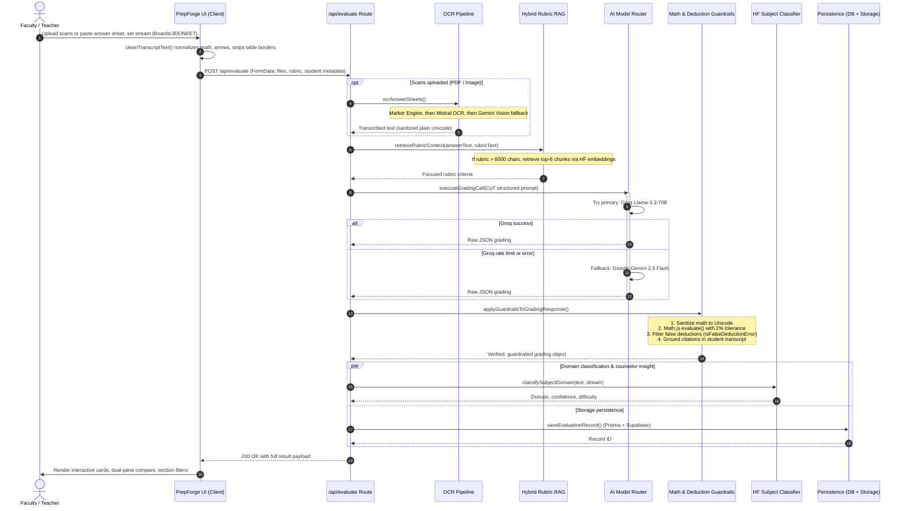
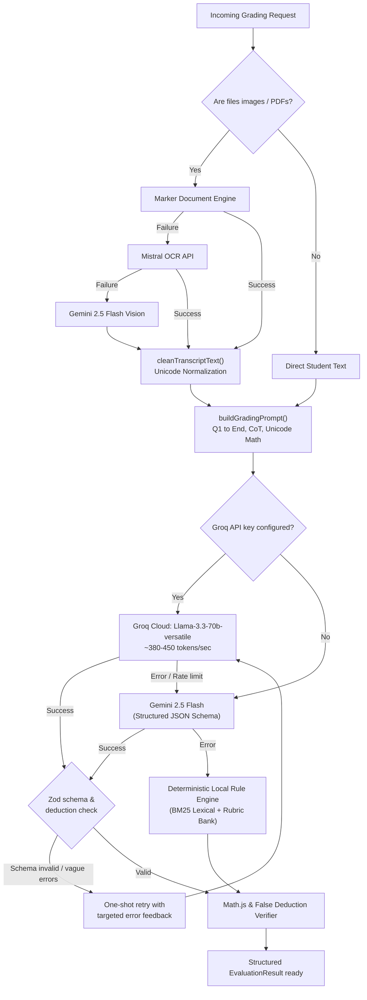
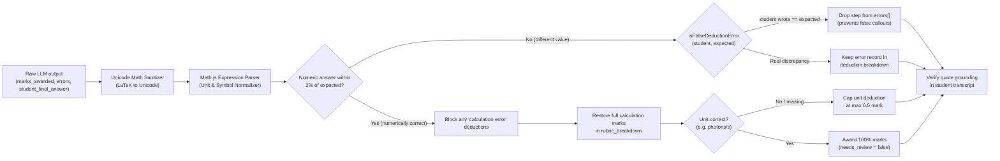
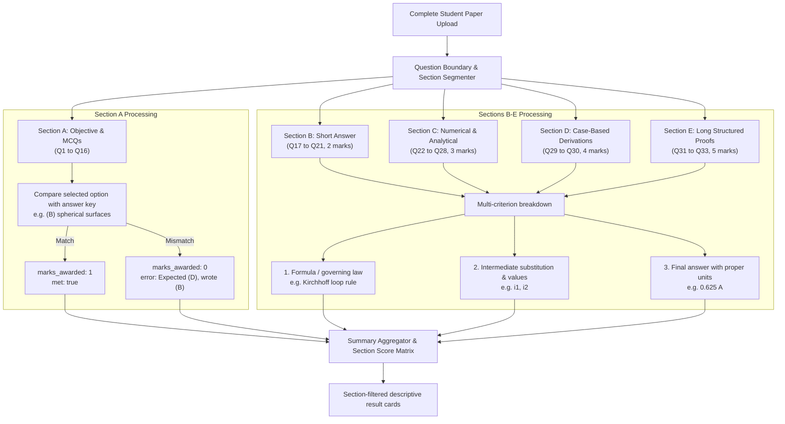
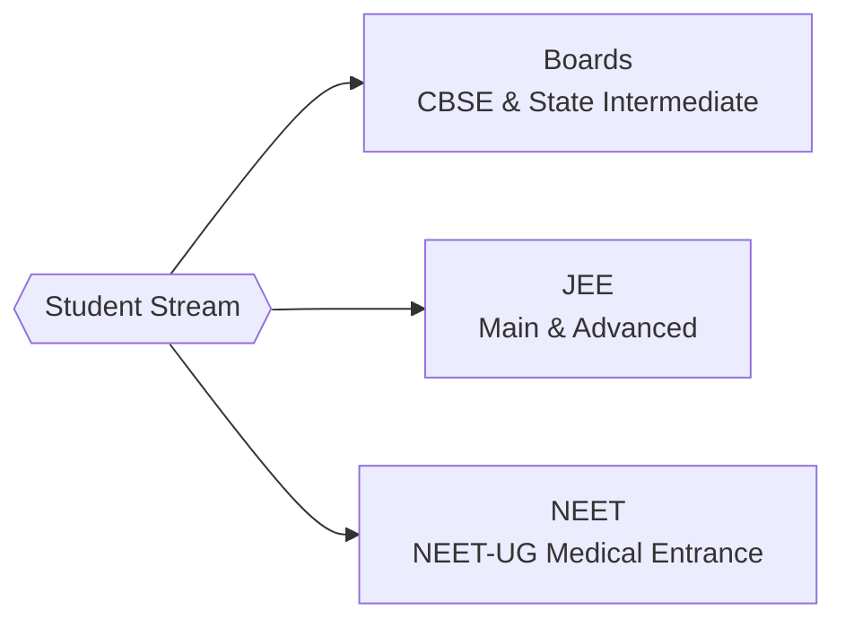
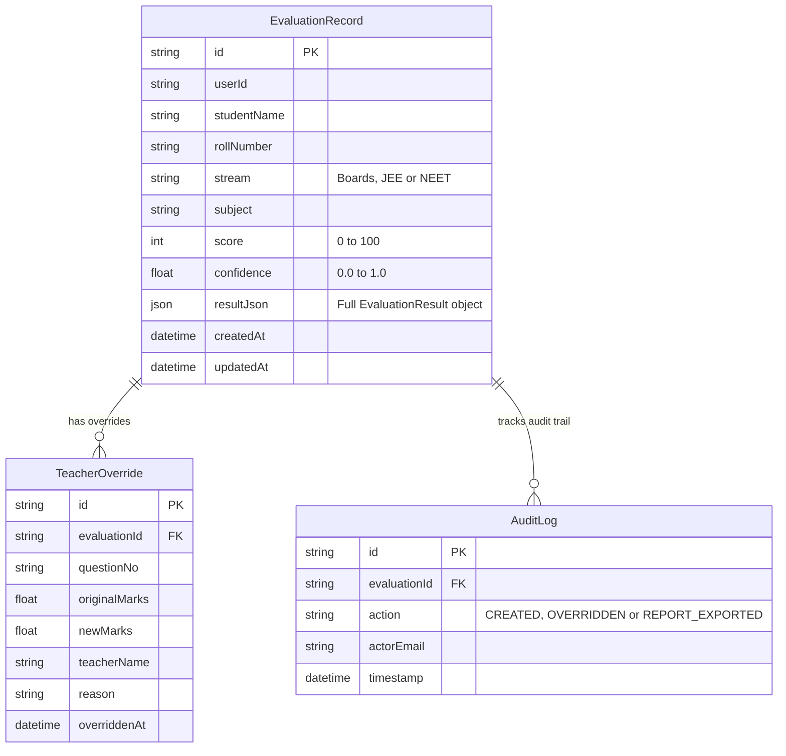
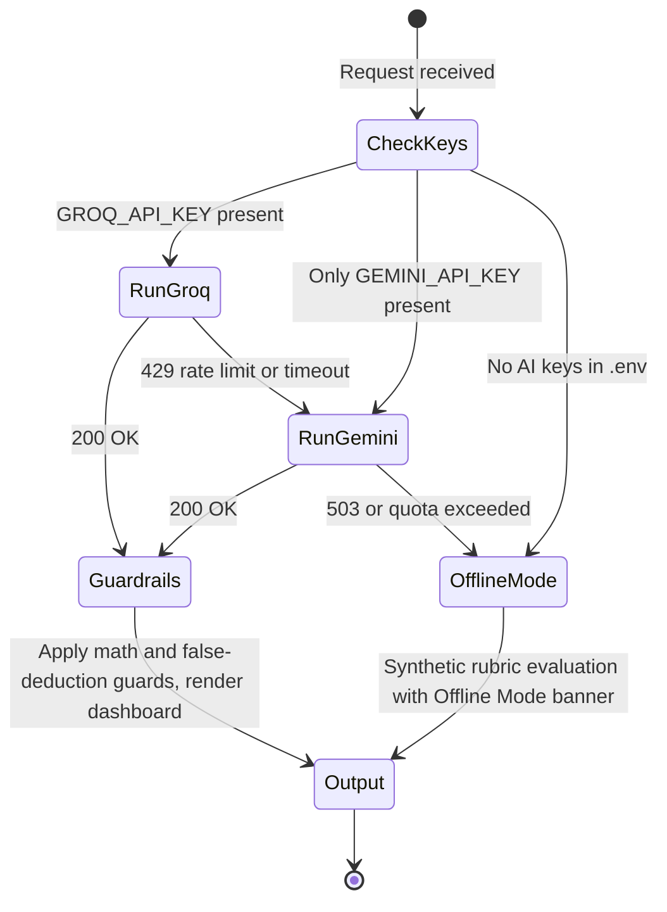

# PrepForge: System Design & Architecture

> **Intelligent evaluation and assessment engine for Indian competitive and board exams (Boards, JEE & NEET)**
>
> Next.js App Router · Multi-model AI routing · Deterministic math guardrails · Zero-shot classification

---

## Table of Contents

1. [Executive Summary & Core Objectives](#1-executive-summary--core-objectives)
2. [High-Level System Architecture](#2-high-level-system-architecture)
3. [End-to-End Request Lifecycle](#3-end-to-end-request-lifecycle)
4. [Multi-Model AI Routing & Fallback Topology](#4-multi-model-ai-routing--fallback-topology)
5. [Latency Profiling & Performance SLAs](#5-latency-profiling--performance-slas)
6. [Deterministic Math Engine & Guardrails](#6-deterministic-math-engine--guardrails)
7. [Full-Paper Evaluation Pipeline (Q1 to End)](#7-full-paper-evaluation-pipeline-q1-to-end)
8. [Multi-Stream Syllabus Specialization](#8-multi-stream-syllabus-specialization)
9. [Data Architecture & Persistence Strategy](#9-data-architecture--persistence-strategy)
10. [Engineering Trade-offs & Design Rationales](#10-engineering-trade-offs--design-rationales)
11. [Failure Modes & Graceful Degradation](#11-failure-modes--graceful-degradation)
12. [Security, Authentication & Data Isolation](#12-security-authentication--data-isolation)

---

## 1. Executive Summary & Core Objectives

### The Problem

Indian high-stakes examinations (**CBSE/State Boards, JEE Main/Advanced, NEET-UG**) assess students through a mix of **1-mark objective questions (Section A MCQs)** and **rigorous multi-step descriptive derivations (Sections B, C, D and E)**.

Generic LLM grading suffers from four recurring failures:

1. **Math hallucinations and arithmetic errors.** LLMs often declare a correct derivation wrong because of tokenization artifacts.
2. **False deductions.** Marks are deducted for "calculation errors" even when the student's numbers and units match the answer key.
3. **Question skips.** Early MCQs (Q1–Q16) are skipped and grading jumps straight to the large subjective questions.
4. **Latency bottlenecks.** Full-page multimodal vision evaluation often takes 25–40 seconds per student, which breaks real-time teacher workflows.

### PrepForge's Solution

PrepForge is a specialized evaluation engine that combines:

- **Fast multi-model AI routing:** Groq Llama-3.3-70B as primary, Gemini 2.5 Flash as fallback.
- **Deterministic math verification:** Math.js with a 2% tolerance.
- **Quote-grounded guardrails:** every cited quote must exist in the student's transcript.

It grades the entire paper sequentially from Question 1 onwards, sanitizes OCR noise, enforces strict deduction proofs, and supports manual faculty overrides.

---

## 2. High-Level System Architecture

The diagram below shows the main system components and their boundaries.

---

## 3. End-to-End Request Lifecycle

When a teacher submits student sheets or typed transcripts, the system runs an automated multi-stage pipeline.

---

## 4. Multi-Model AI Routing & Fallback Topology

PrepForge does not rely on a single model. Academic grading needs both **sub-second-class inference speed** and **reliable JSON schema adherence**, so a hierarchical multi-model router is used.

### Provider Responsibilities

| Role | Primary | Fallback 1 | Fallback 2 | Why this choice |
| :--- | :--- | :--- | :--- | :--- |
| **Document OCR** | Marker Engine (local / Datalab) | Mistral OCR | Gemini 2.5 Flash Vision | Marker preserves tables and math; Mistral specializes in handwriting; Gemini handles complex rotations. |
| **Grading inference** | Groq (Llama-3.3-70B) | Gemini 2.5 Flash | Deterministic local engine | Groq produces a complete 30-question grading JSON in under 2.5 s; Gemini guarantees strict schema typing. |
| **Embeddings & RAG** | HF `bge-small-en-v1.5` | Lexical BM25 chunking | Full-context ingest | 384-dim embeddings run in ~120 ms; BM25 guarantees keyword matches for laws (e.g. Kirchhoff, Snell). |
| **Classification** | HF `bart-large-mnli` | Groq prompt | Deterministic map | Zero-shot NLI maps mixed Physics/Chemistry content without manual prompt drift. |

---

## 5. Latency Profiling & Performance SLAs

Latency is a primary constraint for institutional adoption. Waiting 30 seconds after uploading a test sheet breaks the faculty workflow, so every stage is optimized.

```mermaid
gantt
    title Typical end-to-end evaluation latency (P50 path, milliseconds)
    dateFormat x
    axisFormat %S.%L s

    section OCR (if scans uploaded)
    Marker / Mistral OCR (1.8 s)          :active, ocr, 0, 1800

    section Sanitization and RAG
    cleanTranscriptText (12 ms)           :active, clean, 1800, 1812
    HF embedding retrieval (180 ms)       :active, rag, 1812, 1992

    section Structured grading
    Groq Llama-3.3-70B (2.1 s)            :active, groq, 1992, 4092
    Gemini fallback path (3.8 s)          :crit, gem, 1992, 5792

    section Guardrails
    Math.js tolerance check (35 ms)       :active, math, 4092, 4127
    Deduction proof verifier (20 ms)      :active, ded, 4127, 4147

    section Parallel classification and storage
    HF domain classification (280 ms)     :active, cls, 4147, 4427
    Supabase storage and DB write (150 ms) :active, db, 4147, 4297
```

### Quantitative Latency Breakdown

| Sub-system | P50 | P95 | Cold start | Optimization technique |
| :--- | ---: | ---: | ---: | :--- |
| **OCR (Marker / Mistral)** | 1,800 ms | 4,200 ms | ~500 ms | Base64 streaming, direct PDF buffer parsing, image compression |
| **Text sanitizer (`cleanTranscriptText`)** | 12 ms | 25 ms | 0 ms | Synchronous regex pipeline, single-pass string transforms |
| **RAG embeddings (`hfEmbeddings`)** | 180 ms | 450 ms | ~1,200 ms | Top-6 chunk cosine pruning; bypassed if rubric < 6,000 characters |
| **Grading (Groq Llama-3.3-70B)** | 2,100 ms | 3,400 ms | 0 ms | LPUs deliver ~400 tok/s; structured system prompts avoid CoT bloat |
| **Grading fallback (Gemini Flash)** | 3,800 ms | 6,800 ms | ~400 ms | Native SDK schema constraint (`responseSchema: structuredGradingGeminiSchema`) |
| **Math guardrail (`verifyNumeric`)** | 35 ms | 60 ms | 0 ms | In-process `mathjs` AST evaluation with 2% tolerance |
| **Persistence (Supabase / Prisma)** | 150 ms | 380 ms | ~200 ms | Parallel `Promise.all` alongside classification |
| **Total turnaround (text)** | **~2.5 s** | **~4.2 s** | n/a | Real-time response for live teacher grading |
| **Total turnaround (full scan)** | **~4.3 s** | **~8.5 s** | n/a | Complete grading of an entire handwritten sheet |

---

## 6. Deterministic Math Engine & Guardrails

LLMs excel at linguistic reasoning but are prone to floating-point and algebraic mistakes. PrepForge applies a **deterministic verification layer** on top of every model output.

### Key Guardrail Invariants

**1. The 2% arithmetic rule (`isWithinTolerance`)**

$$
\frac{\lvert \text{actual} - \text{expected} \rvert}{\max\left(\lvert \text{expected} \rvert,\ 10^{-15}\right)} \le 0.02
$$

If this holds, the AI is barred from claiming the student miscalculated.

**2. False-deduction elimination (`isFalseDeductionError`)**

A deduction item is dropped from `errors[]` when either condition holds:

$$
\text{normalize}(S_{\text{student}}) = \text{normalize}(S_{\text{expected}})
$$

$$
\lvert V_{\text{student}} - V_{\text{expected}} \rvert \le 0.02 \cdot V_{\text{expected}}
$$

Correct student work never appears inside a red deduction box.

**3. Capped unit penalty**

If the numerical value is correct but the unit is omitted (for example `1.01 × 10⁴` written without `photons/s`), the system enforces a maximum deduction of **0.5 marks**, preventing catastrophic mark drops.

**4. Quote grounding (`isQuoteGrounded`)**

Every quotation cited by the AI is matched against the raw OCR transcript using 3-word sliding n-grams. If a citation is hallucinated, it is pruned and the question's confidence score is reduced by **0.15**.

---

## 7. Full-Paper Evaluation Pipeline (Q1 to End)

Indian examinations require handling the full set of questions sequentially.

---

## 8. Multi-Stream Syllabus Specialization

PrepForge configures its domain context according to the student's academic stream.

| Stream | Curriculum | Format emphasis | Domain labels | Section rule |
| :--- | :--- | :--- | :--- | :--- |
| **Boards** | CBSE & State Intermediate | Detailed theory, diagrams, standard units | Current Electricity, Optics, Vectors, Organic | Mandatory step marking, definition citations |
| **JEE** | JEE Main & JEE Advanced | Multi-concept physics, advanced calculus, physical chemistry | Mechanics, Electromagnetism, Calculus, Kinetics | 2% tolerance on multi-step arithmetic, vector signs |
| **NEET** | NEET-UG Medical Entrance | NCERT factual accuracy, biological nomenclature, units | Physiology, Genetics, Ecology, Physical Optics | Zero tolerance on incorrect bio-terms, standard half-life |

---

## 9. Data Architecture & Persistence Strategy

The system uses a dual-tier persistence model: **PostgreSQL (via Prisma ORM)** for production and **local SQLite / in-memory fallback** for zero-dependency offline mode.

---

## 10. Engineering Trade-offs & Design Rationales

Each major architectural choice is grounded in an explicit trade-off.

| Component | Choice made | Alternative considered | Trade-off / rationale |
| :--- | :--- | :--- | :--- |
| **AI inference** | Groq Llama-3.3-70B as primary | Gemini-only or GPT-4o | **Latency vs tooling.** GPT-4o takes 8–14 s for 30 questions; Groq takes ~2.1 s (~400 tok/s). We give up native multimodal vision in primary inference for an order-of-magnitude speedup, and isolate OCR into a dedicated first stage. |
| **Math representation** | Plain-text Unicode (`×`, `÷`, `·`, `→`, `10⁴`) | LaTeX (`\frac`, `\times`, `$...$`) | **Robustness vs typesetting.** Raw LaTeX is easily corrupted inside JSON strings (`\times` becomes a tab plus `imes`, `\frac` becomes a form-feed plus `rac`). Unicode survives every database, JSON parser and clipboard. |
| **Arithmetic verification** | Math.js AST + 2% tolerance | LLM self-consistency voting | **Determinism vs API cost.** Three parallel LLM checks triple API cost and quadruple latency. `math.evaluate()` in Node.js takes ~35 ms and gives deterministic results. |
| **Rubric ingestion** | Hybrid RAG (embed only if rubric > 6k chars) | Always embed / vector DB | **Simplicity vs scale.** About 90% of rubrics fit within 4,000 characters. Sending the full rubric into Llama-3.3's 128k context removes retrieval misses at negligible latency cost. |
| **State management** | React state + server-action sync | Redux Toolkit / Zustand | **Zero overhead.** The grading workflow is mostly transactional; local React state with optimistic updates and background REST persistence gives the smallest bundle. |

---

## 11. Failure Modes & Graceful Degradation

PrepForge degrades gracefully across several layers.

1. **Zero-key offline mode.** With no API keys configured, PrepForge boots the deterministic keyword and syllabus-node rule engine and scores answers locally, so teachers are never blocked.
2. **OCR failure mode.** If Marker or Mistral fails (for example on corrupt file headers), the request transparently falls back to Gemini Vision base64 chunk processing.
3. **Structured schema repair.** If a model returns malformed JSON, a targeted one-shot retry passes the exact schema-failure trace back to the model for correction.

---

## 12. Security, Authentication & Data Isolation

1. **Clerk JWT authentication.** All `/evaluate`, `/api/*` and history endpoints are protected by `@clerk/nextjs` middleware, with automatic redirects to `/sign-in`.
2. **Tenant and student isolation.** Evaluation records in PostgreSQL and SQLite are indexed by `userId`. Faculty can only view, patch or delete evaluations created within their own authorized session.
3. **Third-party inference data handling.** Answer text sent to Groq and Gemini should be covered by ephemeral inference with prompt-data retention disabled, where enterprise tiers support it.
4. **File type enforcement.** The upload gateway permits only `image/jpeg`, `image/png`, `image/webp` and `application/pdf`, up to 5 MB, and rejects executable or unverified MIME types before anything is written to disk.

---

*Authored by the PrepForge Engineering Core Team. Designed for high-concurrency educational institution deployments.*
