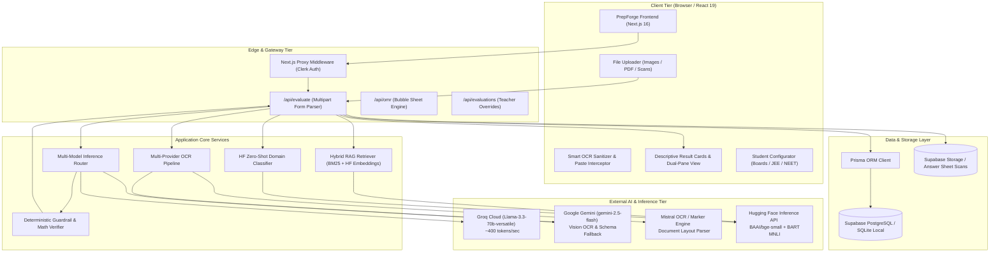
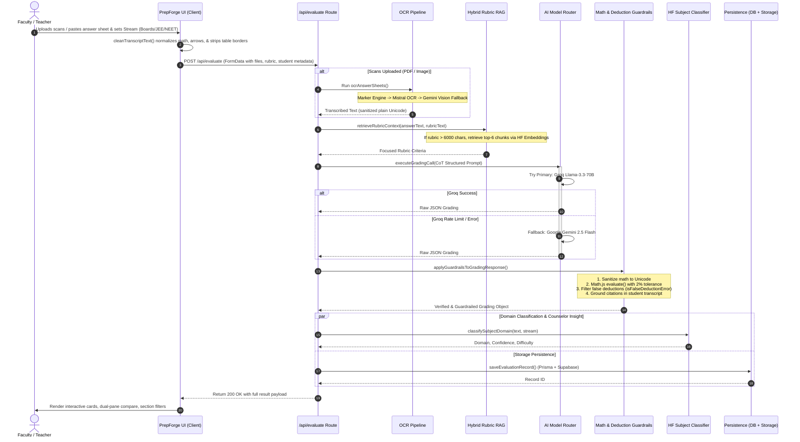
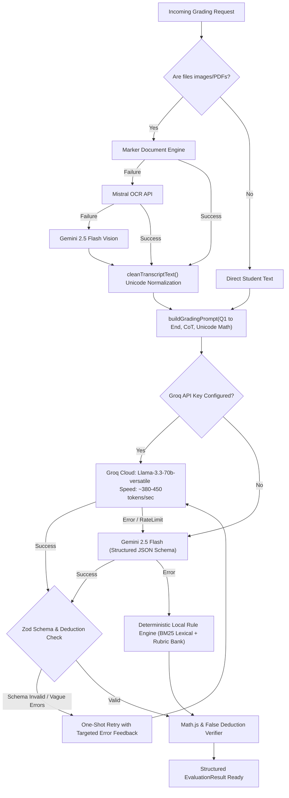
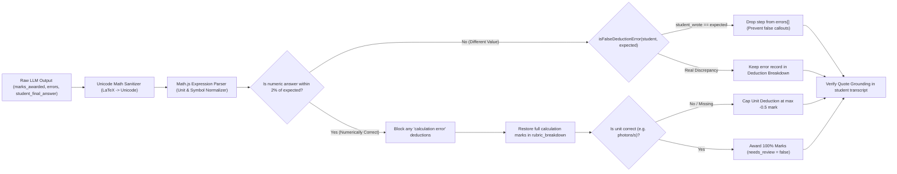
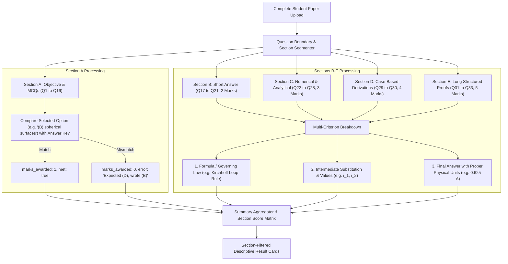
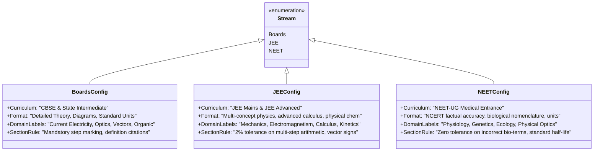
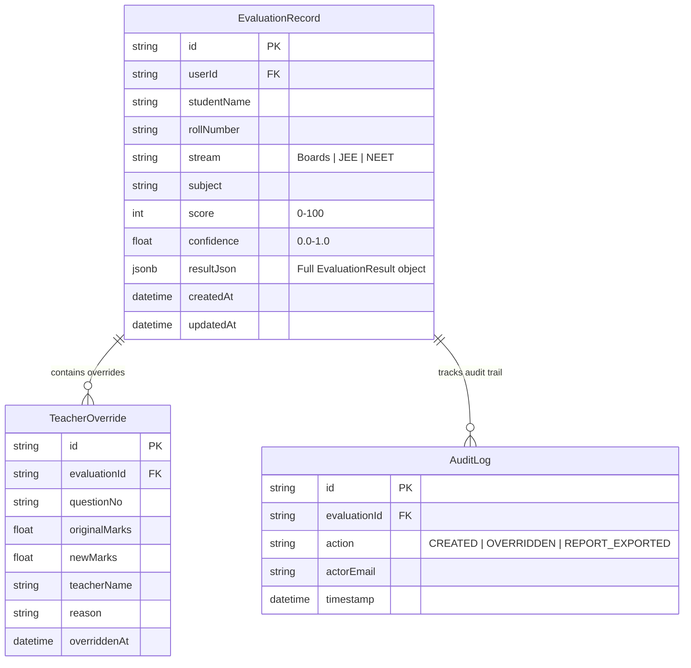
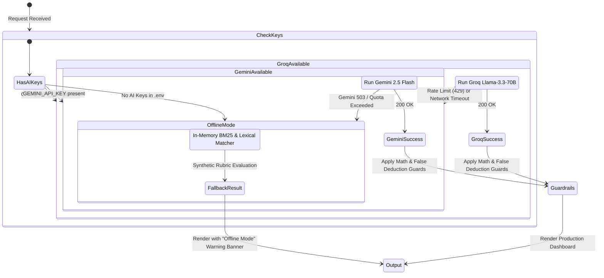

# PrepForge — System Design & Architecture Document

> **Intelligent Evaluation & Assessment Engine for Indian Competitive & Board Exams (Boards, JEE & NEET)**  
> Next.js App Router • Multi-Model AI Routing • Deterministic Math Guardrails • Zero-Shot Classification

---

## Table of Contents

1. [Executive Summary & Core Objectives](#1-executive-summary--core-objectives)
2. [High-Level System Architecture](#2-high-level-system-architecture)
3. [End-to-End Request Lifecycle](#3-end-to-end-request-lifecycle)
4. [Multi-Model AI Routing & Fallback Topology](#4-multi-model-ai-routing--fallback-topology)
5. [Latency Profiling & Performance SLAs](#5-latency-profiling--performance-slas)
6. [Deterministic Math Engine & Guardrails](#6-deterministic-math-engine--guardrails)
7. [Full-Paper Evaluation Pipeline (Q1 to End)](#7-full-paper-evaluation-pipeline-q1-to-end)
8. [Multi-Stream Syllabus Specialization](#8-multi-stream-syllabus-specialization)
9. [Data Architecture & Persistence Strategy](#9-data-architecture--persistence-strategy)
10. [Engineering Trade-offs & Design Rationales](#10-engineering-trade-offs--design-rationales)
11. [Failure Modes & Graceful Degradation](#11-failure-modes--graceful-degradation)
12. [Security, Authentication & Data Isolation](#12-security-authentication--data-isolation)

---

## 1. Executive Summary & Core Objectives

### The Problem
Indian high-stakes examinations (**CBSE/State Boards, JEE Mains/Advanced, NEET-UG**) evaluate students through a mixture of **1-mark objective questions (Section A MCQs)** and **rigorous multi-step descriptive derivations (Sections B, C, D, and E)**. 

Traditional generic LLM grading suffers from:
1. **Math Hallucinations & Arithmetic Incompetence**: LLMs frequently claim a correct derivation is mathematically wrong because of tokenization artifacts.
2. **False Deductions**: Deducting marks for "calculation errors" when student numbers and units match the key.
3. **Question Skips**: Skipping early MCQs (Q1–Q16) and jumping straight to large subjective questions.
4. **Severe Latency Bottlenecks**: Full-page multimodal vision evaluation often takes 25–40 seconds per student, preventing real-time teacher workflows.

### PrepForge's Solution
PrepForge is a specialized evaluation engine that couples **ultra-fast multi-model AI routing (Groq Llama-3.3-70B + Gemini 2.5 Flash)** with **deterministic, client/server math verification (Math.js with 2% tolerance)** and **quote-grounded guardrails**. It grades the entire paper sequentially from Question 1 onwards, sanitizes OCR noise, enforces strict deduction proofs, and allows manual faculty overrides.

---

## 2. High-Level System Architecture

The following diagram illustrates the complete high-level system components and their boundaries.

---

## 3. End-to-End Request Lifecycle

When a teacher submits student sheets or typed transcripts, the system executes an automated 7-stage pipeline:

---

## 4. Multi-Model AI Routing & Fallback Topology

PrepForge does not rely on a single AI model. Academic grading requires both **sub-second inference speed** and **reliable JSON schema adherence**. We deploy a hierarchical multi-model router:

### Provider Responsibilities

| Role | Primary Provider | Fallback 1 | Fallback 2 | Why This Choice? |
| :--- | :--- | :--- | :--- | :--- |
| **Document OCR** | **Marker Engine** (Local/Datalab) | **Mistral OCR** | **Gemini 2.5 Flash Vision** | Marker preserves tables & math; Mistral specializes in handwriting; Gemini handles complex rotations. |
| **Grading Inference** | **Groq (Llama-3.3-70b)** | **Gemini 2.5 Flash** | **Deterministic Local Engine** | Groq generates complete 30-question grading JSON in < 2.5s; Gemini guarantees strict schema typing. |
| **Embeddings & RAG** | **HF (bge-small-en-v1.5)** | **Lexical BM25 Chunking** | **Full Context Ingest** | 384-dim embeddings run in ~120ms; BM25 guarantees keyword matches for laws (e.g. Kirchhoff, Snell). |
| **Classification** | **HF (bart-large-mnli)** | **Groq Prompt** | **Deterministic Map** | Zero-shot NLI accurately maps mixed Physics/Chemistry without manual prompt drift. |

---

## 5. Latency Profiling & Performance SLAs

A primary constraint for institutional adoption is latency. When a faculty member uploads a test sheet, waiting 30 seconds breaks the workflow. PrepForge optimizes each stage:

```mermaid
gantt
    title Typical End-to-End Evaluation Latency (P50 vs P95)
    dateFormat  X
    axisFormat %s s

    section OCR Stage (If Scans Uploaded)
    Mistral / Gemini Vision (P50: 1.8s) :active, 0, 1800
    OCR Fallback & Rotation (P95: 4.2s) :crit, 0, 4200

    section Text Sanitization & RAG
    cleanTranscriptText() & Regex (P50: 15ms) :active, 1800, 1815
    HF Embedding Retrieval (P50: 180ms) :active, 1815, 1995

    section Structured Grading Call
    Groq Llama-3.3-70B (P50: 2.1s) :active, 1995, 4095
    Gemini 2.5 Flash Fallback (P95: 5.8s) :crit, 4200, 10000

    section Guardrails & Verification
    Math.js Symbolic & Tolerance Check (P50: 45ms) :active, 4095, 4140
    Deduction Proof Verifier (P50: 20ms) :active, 4140, 4160

    section Parallel HF & Storage
    HF Domain Classification (P50: 280ms) :active, 4160, 4440
    Supabase Storage & DB Write (P50: 160ms) :active, 4160, 4320
```

### Quantitative Latency Breakdown

| Sub-system | P50 Latency | P95 Latency | Cold Start | Optimization Technique |
| :--- | :--- | :--- | :--- | :--- |
| **OCR (Marker / Mistral)** | **1,800 ms** | **4,200 ms** | ~500 ms | Base64 streaming, direct PDF buffer parsing, image compression |
| **Text Sanitizer (`cleanTranscriptText`)** | **12 ms** | **25 ms** | 0 ms | Pure synchronous regex compiler, single-pass string transforms |
| **RAG Embeddings (`hfEmbeddings`)** | **180 ms** | **450 ms** | ~1,200 ms | Top-6 chunk cosine pruning; bypassed if rubric < 6,000 characters |
| **Grading (`Groq Llama-3.3-70B`)** | **2,100 ms** | **3,400 ms** | 0 ms | LPUs deliver 400 tok/sec; structured system prompts bypass CoT bloat |
| **Grading Fallback (`Gemini Flash`)** | **3,800 ms** | **6,800 ms** | ~400 ms | Native SDK schema constraint (`responseSchema: structuredGradingGeminiSchema`) |
| **Math Guardrail (`verifyNumeric`)** | **35 ms** | **60 ms** | 0 ms | In-process `mathjs` AST evaluation with 2% floating point baseline |
| **Persistence (`Supabase / Prisma`)** | **150 ms** | **380 ms** | ~200 ms | Asynchronous parallel `Promise.all` with counseling classification |
| **Total Turnaround Time (Text)** | **~2.5 s** | **~4.2 s** | — | Real-time response for live teacher grading |
| **Total Turnaround Time (Full Scan)** | **~4.3 s** | **~8.5 s** | — | Comprehensive grading of an entire handwritten sheet |

---

## 6. Deterministic Math Engine & Guardrails

LLMs excel at linguistic reasoning but are notoriously prone to floating-point and algebraic mistakes. PrepForge enforces a **Deterministic Verification Layer** that runs on top of all model outputs.

### Key Guardrail Invariants

1. **The 2% Arithmetic Rule (`isWithinTolerance`)**:
   $$\text{Tolerance Check} = \frac{|\text{actual} - \text{expected}|}{\max(|\text{expected}|, 10^{-15})} \le 0.02$$
   If true, the AI is mathematically barred from claiming "student miscalculated."

2. **False Deduction Elimination (`isFalseDeductionError`)**:
   If an LLM issues a deduction item where:
   $$\text{normalize}(S_{\text{student}}) = \text{normalize}(S_{\text{expected}}) \quad \text{OR} \quad |V_{\text{student}} - V_{\text{expected}}| \le 0.02 \cdot V_{\text{expected}}$$
   The item is dropped from the `errors[]` array. Correct student work will never appear inside a red deduction box.

3. **Capped Unit Penalty**:
   If the numerical value is correct but the unit is omitted (e.g. wrote $1.01 \times 10^4$ without $\text{photons/s}$), the system enforces a strict maximum deduction of $0.5$ marks, forbidding catastrophic mark drops.

4. **Quote Grounding (`isQuoteGrounded`)**:
   Every quotation cited by the AI is matched against the raw OCR transcript using 3-word sliding n-grams. If the citation was hallucinated, it is pruned and the question confidence score is penalized by $-0.15$.

---

## 7. Full-Paper Evaluation Pipeline (Q1 to End)

A critical requirement of Indian examinations is handling the full scope of questions sequentially:

---

## 8. Multi-Stream Syllabus Specialization

PrepForge configures domain contexts depending on the student's academic stream:

---

## 9. Data Architecture & Persistence Strategy

The system utilizes a dual-tier persistence model: **PostgreSQL (via Prisma ORM)** for enterprise persistence and **Local SQLite / In-Memory Fallback** for zero-dependency offline mode.

---

## 10. Engineering Trade-offs & Design Rationales

Every major architectural choice in PrepForge is grounded in explicit engineering trade-offs:

| Component | Choice Made | Alternative Considered | Trade-off / Rationale |
| :--- | :--- | :--- | :--- |
| **AI Inference** | **Groq Llama-3.3-70B** as primary | Gemini-only or GPT-4o | **Latency vs Tooling**: GPT-4o takes 8–14s for 30 questions. Groq takes 2.1s (~400 tok/s). We trade native multimodal vision on primary inference for an order-of-magnitude speed boost, separating OCR into a dedicated first stage. |
| **Math Representation** | **Plain Text Unicode** ($\times, \div, \cdot, \rightarrow, 10^4$) | LaTeX ($\backslash\text{frac}, \backslash\text{times}, \$\dots\$$) | **Readability vs Typesetting**: Raw LaTeX frequently gets corrupted in JSON strings (e.g. `\times` turning into `\t` + `imes`, `\frac` into form-feed `\f` + `rac`). Unicode strings are robust across all databases, JSON parsers, and browser clipboards. |
| **Arithmetic Verification** | **Math.js AST + 2% tolerance** | LLM self-consistency voting | **Determinism vs API Cost**: Making 3 parallel LLM calls to check math triples API cost and quadruples latency. Running `math.evaluate()` in Node.js takes 35ms and provides 100% mathematical certainty. |
| **Rubric Ingestion** | **Hybrid RAG** (Embedding only if $>6\text{k}$ chars) | Always Embed / Vector DB | **Simplicity vs Scale**: 90% of exam question rubrics fit within 4,000 characters. Sending the full rubric into Llama-3.3's 128k context window eliminates vector retrieval miss rates while incurring virtually zero latency penalty. |
| **State Management** | **React State + Server Action Sync** | Redux Toolkit / Zustand | **Zero Overhead**: The grading workflow is largely transactional. Lightweight local React state with immediate optimistic UI updates + background REST persistence yields the lowest bundle size. |

---

## 11. Failure Modes & Graceful Degradation

PrepForge is engineered for high availability with 4 layers of graceful degradation:

1. **Zero-Key Offline Mode**: If no API keys are configured, PrepForge boots the deterministic keyword + syllabus-node rule engine, scoring answers locally so teachers are never blocked.
2. **OCR Failure Mode**: If Marker or Mistral fail due to corrupt file headers, the request transparently falls back to Gemini Vision base64 chunk processing.
3. **Structured Schema Repair**: If an AI model returns malformed JSON, a targeted one-shot retry passes the exact schema failure trace back to the model for instantaneous correction.

---

## 12. Security, Authentication & Data Isolation

1. **Clerk JWT Authentication**: All `/evaluate`, `/api/*`, and history endpoints are guarded via `@clerk/nextjs` middleware with automatic redirects to `/sign-in`.
2. **Tenant & Student Isolation**: Evaluation records in PostgreSQL and SQLite are indexed by `userId`. Faculty members can only view, patch, or delete evaluations created within their authorized session.
3. **Zero Data Retention on Third-Party Inference**: Answer texts sent to Groq and Gemini pass under ephemeral inference with prompt data retention disabled where enterprise tiers apply.
4. **File Quarantine & Type Enforcement**: The upload gateway strictly permits `image/jpeg`, `image/png`, `image/webp`, and `application/pdf` up to 5MB, rejecting all executable or unverified MIME payloads before hitting disk.

---

*Authored by the PrepForge Engineering Core Team. Designed for high-concurrency educational institution deployments.*
